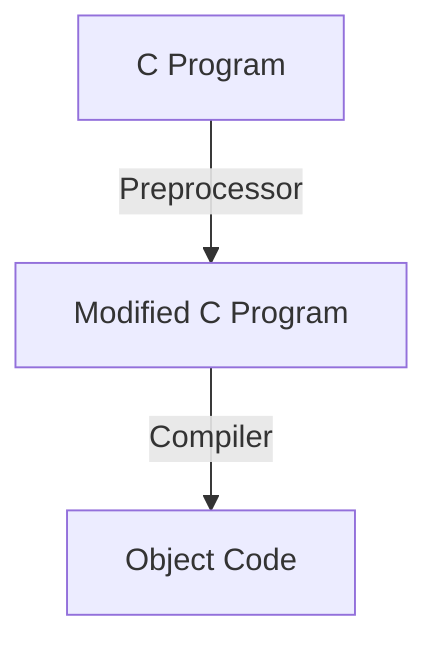

# Compiling

## Preprocessor
\- brings in library files  
\- `#include` indicates an import  
\- `#define` indicates a macro  
\- no semicolon, no equals


<u>Changes</u>  
\- replaces each comment character with a single space character  
\- can remove unnecessary whitespace characters

<u>Directives</u>  
\- whitespace does not matter  
\- always starts with `#`  
\- to continue to newline, use `\`  
\- good practice to put a comment directly after directive to describe its function

<u>Imports</u>  
\- Files are literally copied into the top of the script

## Macros
\- directly replaced with their value during preprocessing

`#define [identifier] [replacement-list]`

<u>Parameterized</u>  
\- missing parameter is replaced with nothing

<u>Pitfalls</u>  
\- not type checked  
\- cannot point to a macro  
\- can be difficult to debug

<u># Operator</u>

<u>Parentheses</u>

<u>Pre-Defined</u>  
\- compilation date and time  
	\_\_DATE\_\_: Mon dd YYYY  
	\_\_TIME\_\_: HH:mm:ss  
\- filetype and contents  
	\_\_LINE\_\_: line number (at invocation)  
	\_\_FILE\_\_: filename (at invocation)

## Conditional Compilation
<u>#IF and #ENDIF</u>  
\- can be used to optionally comment code depending on macro value
```c
#define DEBUG 1

#IF DEBUG
printf("Value of i: %d\n", i);
#ENDIF
```

<u>#IFDEF and #IFNDEF</u>

<u>#ELIF and #ELSE</u>
